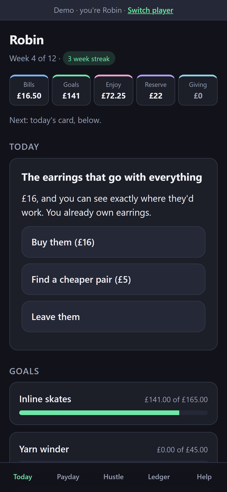
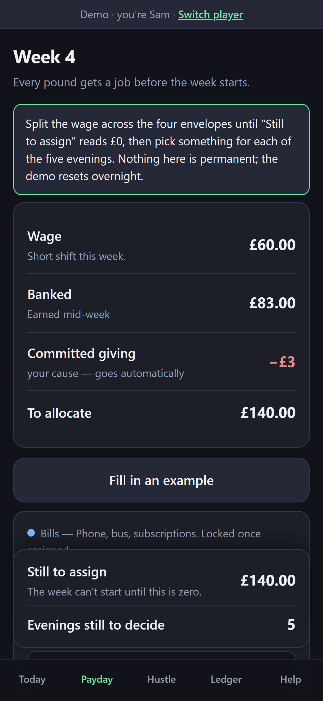
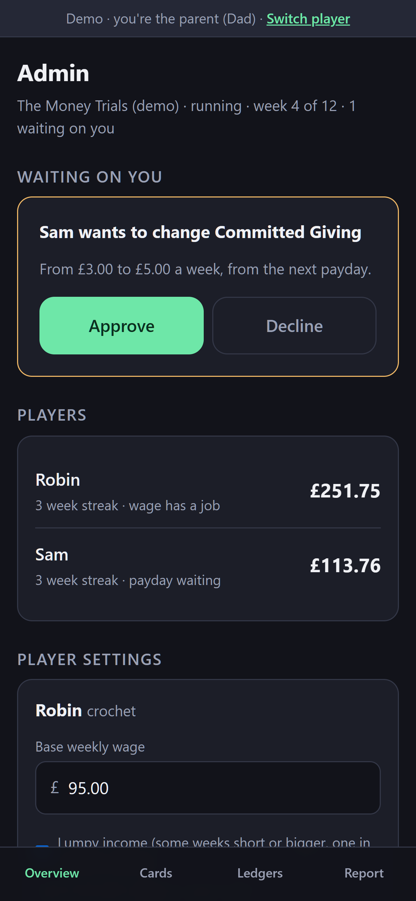

# The Money Trials: a product I shipped with Claude Code, from spec to real users

The Money Trials is a 12-week budgeting game for teenagers. I wrote the spec, made the design calls and tested it as a user. Claude Code wrote the code. It took four evening sessions, five hours in total. My two daughters have played it every day since Monday 19 October 2026.

The clearest product call came from simulation. 20,000 simulated seasons showed the game could be beaten by working every evening, so I capped extra shifts at two a week. The advantage fell from £1,320 to £528.

Try the demo at [moneytrials.co.uk](https://moneytrials.co.uk). The players are made up and it resets every night. The code, tests and simulation scripts are in this repo.

## The problem and the bet

Teenagers get money at birthdays and Christmas with no practice deciding what to do with it. The bet is that repetition builds the habit: many small decisions, each with a visible consequence, compressed into twelve weeks.

Three principles from the spec drive every mechanic:

1. **Every pound gets a job.** The week cannot advance until income is fully allocated.
2. **Acquisition is the reward.** Players buy things they chose and wanted.
3. **Consequences arrive quickly.** Something resolves every week.

The spec also set anti-goals. No moralising in the copy. No penalty for spending on enjoyment or for giving nothing. Giving is reported and never scored.

The players don't have jobs, so the game gives them one: a Saturday job with a base wage of £95 a week. Some weeks are short, some are boosted and occasionally one pays nothing. With no income there is nothing to budget.

## How I worked with Claude Code

I owned the product decisions. Claude Code wrote the code.

I wrote a design spec first, then built in four phases. Phase 1 was playable end to end before anything else was added: payday, five envelopes, a daily card, goals and weekly survival. Later phases added evenings, a side hustle making and selling crafts, giving asks and fundraisers, and a parent admin screen.

My part was the brief, the design calls and testing as a user. Claude Code ran on Claude Sonnet 5.5 and Claude Opus 5.5. The stack is Next.js and TypeScript on Vercel, with Postgres on Neon and a daily job for the day rollover.

Each feature has a test script that runs against the real engine and a local Postgres. There are six, and `npm test` runs them all.

Decisions stayed with me. When the simulation showed a problem with shift pay, Claude Code left the number as the spec set it and put the choice to me.

Claude was often wrong in planning. Loans are the biggest example: they were in the plan and were built, and I removed them on the day play started. Card writing needed me too: cards generated from my prompts sometimes sounded silly.

## Two decisions the evidence forced

The game had one dominant strategy, and simulation found it before my daughters did.

On 21 September I ran 20,000 simulated seasons against the game's rules. Working every evening was worth £1,320 more than working none, across a season whose base wage totals £1,140. An extra shift paid £22, so five shifts out-earned the £95 job. A game with one best strategy stops being a decision.

There were two options. Cut shift pay to £8–£10, or cap shifts at two a week and keep £22 so one evening still feels worth taking. I chose the cap on 6 October. The gap fell to £528.

Bots then played 24 full seasons through the real engine. Careful bots reached both goals in all 8 of their seasons, mixed bots in 3 of 8, and spendy bots in none. The bots are crude: fixed allocations, and none of them reacts to a lean week or to market results.

The same run showed a careful player runs out of goals. I added the option to buy a funded goal and start the next one. Real play bears it out: both players have bought goals and moved on to new ones.

The second decision was the payday gate. A soft version of "every pound gets a job" let leftover money be nibbled by a small impulse buy. Under that rule, £47 left unassigned cost £5. Ignoring the principle was almost free. On 18 September I made the gate strict: payday refuses to go through until "still to assign" reads £0.

## What real play showed

Both my daughters play every day, in under five minutes. Neither has missed a day or a payday. After four completed weeks, both had survived every week with no failed obligation.

They play differently. One is conservative: she takes lots of shifts, reaches her goals quickly and gives generously, £42 so far. She bought crochet patterns and storage boxes and has fully saved £50 for a concert ticket. The other set bigger goals and gives less, though still a significant amount: £30. She bought trainers and has fully saved £70 for a mixer.

The game fed a real hobby. One of them is building stock for a real craft sale, and the game helped her plan the stock and keep an inventory.

The surprise was a fundraiser. One of them started one for herself, named "Me", with a £67 target. Her sister gave £2.

What I got wrong was the interface. As the parent I couldn't tell why something was waiting for me, or what was happening each day. The guidance is weak and it looks plain. A first UI pass went live on the public demo on 23 November: one tap to try it as a player or as the parent, a clearer Today screen, and payday explained as you go.

I removed loans on the day play started. Under-18s can't get credit in the UK, and I didn't want it shown as an easy option.

Next time the season will be four to six weeks. Twelve is too long. Four to six is enough to play it, reflect, learn and go again.

## What this doesn't show

This is one family's evidence, with no evals or cost model behind it.

- **Evals.** The game has no AI model in it, so there were no model evals to run. The test scripts and simulations check the rules and the engine.
- **Inference cost.** None at runtime. The build ran on a Claude Pro plan at £18 a month that I already had. The only other cost was the domain.
- **Sample.** Two players in one family. The season is half finished at the time of writing.

## Links

- Demo: [moneytrials.co.uk](https://moneytrials.co.uk)
- Code: [github.com/adrianlester/moneytrials](https://github.com/adrianlester/moneytrials)
- Simulation of 20,000 seasons against the rules: [`scripts/season-sim.mjs`](scripts/season-sim.mjs)
- Bot players through the real engine: [`scripts/play-season.ts`](scripts/play-season.ts)
- Tests: `npm test`
